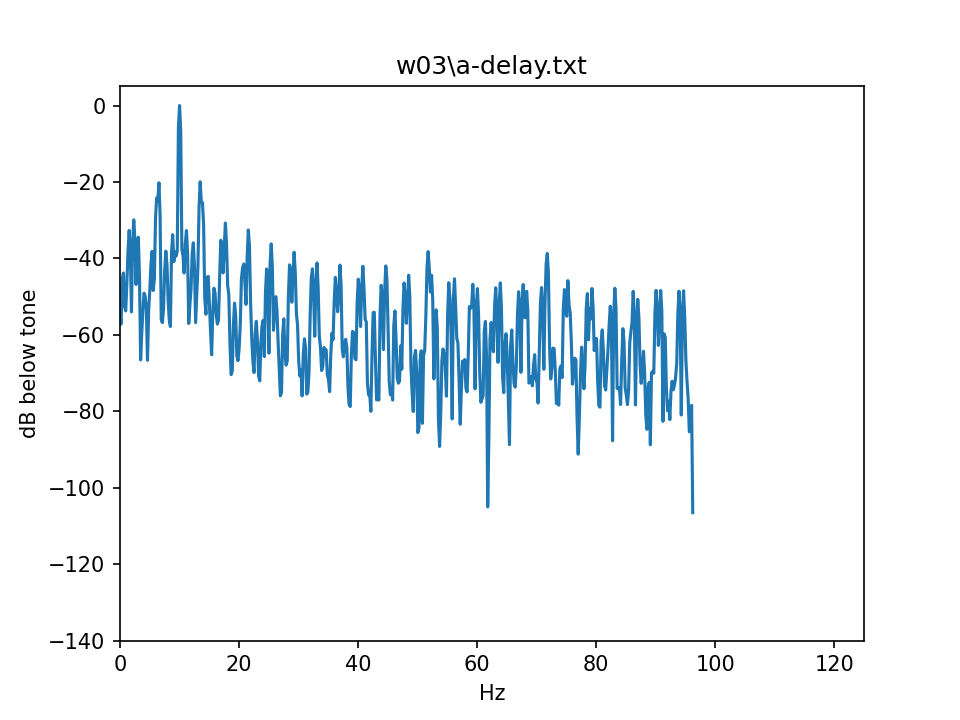
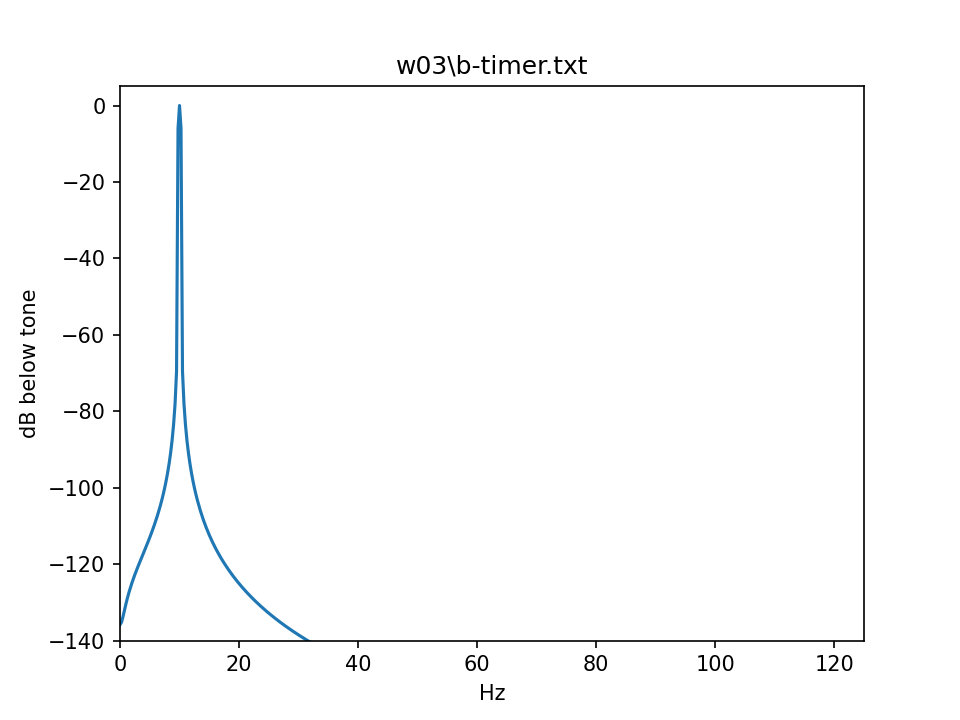

# W03 Record Sheet

**Name** 鄭宇峻  **Student ID** NQ6141054  **Date** 2026-09-24

**紀錄更新日期：2026-09-30。** A／B／C 原始量測日期為 2026-09-24；Sketch D 於 2026-09-30 補測。以下數值來自保存的實測資料，未以估計值補齊；姓名、學號已依本人提供資料填入，外部提交狀態仍待確認。

本檔為工作版；提交副本放在 [w03/RECORD_SHEET.md](w03/RECORD_SHEET.md)，本次同步日期為 2026-09-30，之後修改時需同步更新副本。

**Units: milliseconds, four decimal places.** The raw files are microseconds; `read.py`
does the conversion. Do not mix the two.

---

## 1 · The three numbers (slide 31)

Fill each row as soon as you have it. A first, then B, then C.

| Version | Mean (ms) | Std dev (ms) | Max dev (ms) | n |
|---|---|---|---|---|
| A · `delay(4)` | 5.1960 | 1.0023 | 7.0000 | 1000 |
| B · timer ISR | 4.0001 | 0.0023 | 0.0730 | 1000 |
| C · `millis()` busy-wait | 4.0023 | 0.5280 | 3.2530 | 1000 |

What each one answers, so you know what you are looking at:

- **Mean** — am I sampling at the rate I claimed? Should land near 4.0000 ms for 250 Hz.
  A mean that is off is a **rate** error, not a jitter error.
- **Std dev** — how much does it wander, typically? This is the jitter figure, and it is
  the one that becomes noise floor in cycle 3.
- **Max dev** — what is the worst single interval? The hard real-time number. One bad
  interval can move an R-peak, and a good average will not save you.

## 2 · Side by side (slide 42)

| Version | Std dev (ms) | Max dev (ms) | Ratio to B | Usable for HRV? |
|---|---|---|---|---|
| A · `delay(4)` | 1.0023 | 7.0000 | 434.13 | 不選用：平均間隔偏離 4 ms，且有明顯抖動 |
| B · timer ISR | 0.0023 | 0.0730 | 1.00 | 定時方案首選；實際 ADC 取樣與 HRV 適用性仍待驗證 |
| C · `millis()` | 0.5280 | 3.2530 | 228.68 | 不優先選用：平均接近 4 ms，但仍有毫秒級偏差 |

Ratio to B = 各版本的樣本標準差 / B 的樣本標準差，使用原始資料計算後才四捨五入到兩位小數；各保留全部 1000 筆，包含啟動首筆。資料來源為 `w03/a-delay.txt`、`w03/b-timer.txt`、`w03/c-millis.txt`。此處是依定時表現做選擇；Sketch B 量到的是 ISR 時間間隔，尚未驗證等間隔 ADC 取樣或完整 HRV 系統。

**Which version has the smallest standard deviation, and by what factor?**

> B 的標準差最小，為 0.0023 ms（四位小數）。使用未四捨五入的標準差計算，A 是 B 的 434.13 倍，C 是 B 的 228.68 倍。此比較包含全部 1000 筆，並非排除啟動首筆後的穩態比較。

**A healthy adult's beat-to-beat variation is tens of milliseconds. Is your worst
version's max deviation small compared to that, or not?**

> 不能視為可忽略：最差的 A 最大偏差是 7.0000 ms。以題目所述「數十毫秒」中的 30 ms 作為比較例子，7 / 30 約為 23.3%，已是相當大的比例，因此不會選 A 作為 HRV 的定時方案。這是時間尺度的比較，不代表已量得 23.3% 的 HRV 誤差。

## 3 · The price of being correct (slide 43)

Check these against your own build output. This is the one pair of numbers the deck gives
you. **Your RAM figures should match exactly** — they were measured on two different machines
and came out the same to the byte. **Your flash figures will be within a few tens of bytes**,
because your project's own file path is compiled into the binary.

| | Flash (bytes) | RAM (bytes) |
|---|---|---|
| Sketch A · `delay(4)` — deck | 273,421 | 22,808 |
| Sketch A — **yours** | 273,389 | 22,808 |
| Sketch B · timer ISR — deck | 279,385 | 22,848 |
| Sketch B — **yours** | 279,353 | 22,848 |

Difference in flash, yours: **5,964** bytes (279,353 - 273,389).

2026-09-24 以本專案的 `espressif32@7.1.3` 設定，分別將套件原版 A、B 放入 `src/main.cpp` 後執行 `platformio run`；兩次均編譯成功。RAM 與講義完全相同，A、B 的 Flash 各比講義少 32 bytes；RAM 差值為 40 bytes。講義表內兩個 Flash 數值精確相減也為 5,964 bytes。

重現上述程式大小時，須使用當時的 UART0 設定（`ARDUINO_USB_CDC_ON_BOOT=0`，即註解掉目前 `platformio.ini` 的 USB CDC build flag）；2026-09-30 為 Sketch D 啟用的原生 USB 設定會改變編譯大小，不應混為同一組結果。

The deck's difference is about **5,950 bytes**. If yours is within a few tens of bytes of
that, you have reproduced it. If it differs by a lot — hundreds or thousands — something is
wrong and you should find out what before you write it down.

## 4 · Noise floors (slides 54–55)

| File | Floor (dB below tone) |
|---|---|
| `a-delay.txt` | -63.95 |
| `b-timer.txt` | -163.22 |
| **Difference (A - B, dB)** | **99.27** |

分析方法：以合成的 10 Hz 正弦波，按照板子以 `micros()` 自我計時取得的實測時間點取樣，再進行加窗 FFT 比較（synthetic tone, real sampling instants, self-timed）。

兩張圖已保存於 `w03/a-delay.txt.png` 與 `w03/b-timer.txt.png`，使用相同的 0–125 Hz、-140 至 +5 dB 座標；噪聲底依課程 `scripts/floor.py` 取 30–120 Hz 範圍內現有頻點的中位數。數值以原始資料重算核對，差值定義為 A - B，表示此合成訊號實驗中 B 的噪聲底比 A 低 99.27 dB，並非實際 ECG 或 ADC 的硬體噪聲量測。

讀圖說明：B 的 -163.22 dB 低於固定圖軸下限 -140 dB，部分頻譜落在圖外，並非漏繪；A 依平均間隔換算的取樣率約為 192.46 Hz，FFT 頻點最高約 96.23 Hz，因此它在約 96–125 Hz 沒有頻點。保留課程原腳本和相同圖軸，未為了視覺效果改變分析方法。

| A：delay(4) | B：timer ISR |
|---|---|
|  |  |

`floor.py` normalises the 10 Hz tone to 0 dB and fixes both axes at `-140 … +5 dB`, so the
two plots are drawn on the same ruler and can be laid side by side as they come out. Do not
change the axis settings — if one plot auto-scales and the other does not, the cleaner
version can end up *looking* noisier, which is the opposite of what you measured.

## 5 · The W02 debt (slide 58)

Paste the two lines Sketch D printed, verbatim:

```
L2 digitalWrite : 63385 us for 100000 toggles -> 1577.66 kHz
L3 register     : 12602 us for 100000 toggles -> 7935.25 kHz
```

L3-to-L2 ratio: **5.03** (L3 frequency / L2 frequency = L2 elapsed time / L3 elapsed time = 63,385 / 12,602).

本項補測日期：**2026-09-30**；ESP32-S3、GPIO4、原生 USB Serial/JTAG（COM7，115200 baud），原始輸出保存於 [w03/d-toggle.txt](w03/d-toggle.txt)。上述兩行依程式原文保留 us 與 kHz。每次迴圈包含一次 HIGH 和一次 LOW，因此程式印出的 100000 toggles 實際指 100000 組高低切換，kHz 是這些迴圈的平均頻率。

沿用課程的兩段測速迴圈，各以 `micros()` 自我計時，完成後才輸出，未使用外部儀器；補上 GPIO 暫存器標頭、USB 連線等待及輸出 flush，均位於計時區段外。本次 L3 約為 L2 的 5.03 倍；一般控制仍優先使用較易維護的 `digitalWrite()`，只有確認 GPIO 操作是效能瓶頸時才考慮平台相依的暫存器寫法。

## 6 · Method note (one sentence, required)

> 使用 `micros()` 自我計時，未使用外部儀器。

Anything else about how you measured that a reader would need in order to repeat it:

> 使用課程套件原版 A、B、C 與相同的 `work()` 負載，各保存 1000 筆原始間隔（包含首筆），量測完成後才透過 115200 baud 串口輸出，並以同一支 `scripts/read.py` 計算樣本標準差及相對 4.0000 ms 的最大絕對偏差，結果以 ms、四位小數記錄；B 的資料取自已保存的 `w03/b-timer.txt`。

量測限制（講義第 28、60 頁）：計時工具與被測程式位於同一顆晶片，這不是獨立驗證；若某個延遲同時影響事件與時間戳，自我計時可能無法辨識，且本次未量到晶片外部接線、ADC 建立時間或主機端延遲，也無法由整數微秒輸出排除更細尺度的抖動。

## 7 · Judgement (one sentence, required)

Name the version you would **not** ship for HRV, and why — **with your own numbers in
the sentence.** "A is worse" is not an answer. "A's max deviation of 4.9 ms is a
significant fraction of a 30 ms beat-to-beat variation, so it would corrupt the HRV
estimate" is.

> 我會拒絕將 A（`delay(4)`）作為 HRV 分析的取樣定時方案，因為其平均間隔為 5.1960 ms、標準差為 1.0023 ms，且相對 4.0000 ms 目標的最大偏差達 7.0000 ms，顯示此負載下未能維持所要求的均勻 250 Hz 時序。

---

## Before you leave

- [x] `a-delay.txt`, `b-timer.txt`, `c-millis.txt` in `w03/` — 1000 raw intervals each
- [x] Both spectrum PNGs in `w03/`
- [x] `read.py` and `floor.py` committed, so your numbers can be reproduced
- [x] Two entries in `AI_USAGE.md` — the 250 Hz prompt and the register-level rewrite（另附 Sketch D 實作紀錄，共 3 筆）
- [x] This sheet, filled in（實驗欄位、姓名及學號已填）
- [ ] Google Form submitted **before you leave the room**

提交核對（2026-09-30）：本次 Git 提交包含原始資料、頻譜、程式、分析腳本及 AI 使用聲明，提交目的地為公開儲存庫 [embedded-ai-portfolio](https://github.com/clare8151214/embedded-ai-portfolio)；遠端同步以 GitHub 的 commit 紀錄為準。Google Form 提交狀態仍未確認，PDF 沒有提供可擷取的表單網址。講義要求課堂當日提交，本紀錄保留真實量測與補測日期，不將 GitHub 上傳視為表單已交或準時繳交的證明。

講義第 58、61 頁另要求將 Sketch D 的兩行輸出與 5.03 倍速度比加入 HW1 報告；目前資料夾沒有 HW1 報告，請將第 5 節內容帶入該報告。第 61 頁的 500 Hz 重測為選做，不是本次必交缺項。
